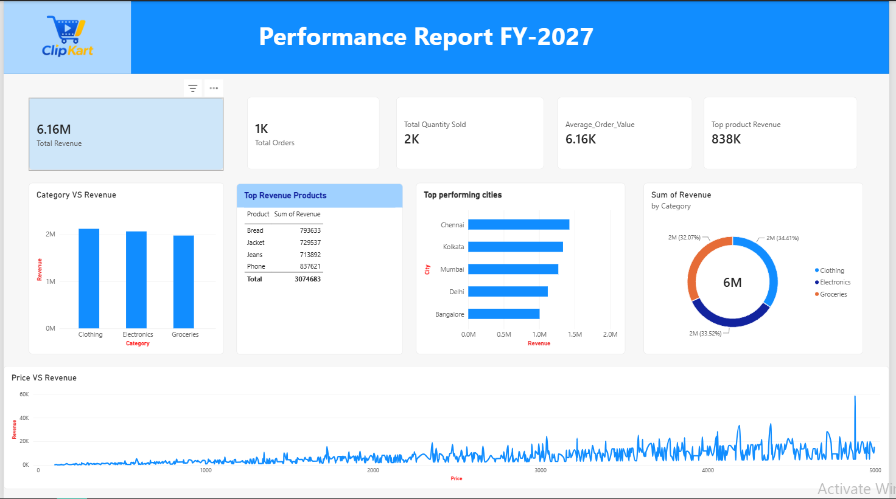

# ClipKart E-commerce Sales Dashboard

## Project Overview

This project presents an interactive Power BI dashboard developed for analyzing ClipKart e-commerce sales data.

The dashboard transforms raw sales data into meaningful business insights by analyzing revenue, orders, quantity sold, category performance, product performance, and city-wise sales.

## Tools & Technologies

- Power BI
- Power Query
- Excel/CSV
- Data Cleaning
- Data Visualization

## Data Preparation

The dataset was prepared using Power Query by:

- Removing duplicate records
- Cleaning and transforming the data
- Recreating the Revenue column using existing fields
- Preparing data for visualization and analysis

## Dashboard KPIs

- Total Revenue
- Total Orders
- Total Quantity Sold

## Dashboard Analysis

The dashboard includes:

- Revenue by Category
- Price vs Revenue Analysis
- Top Revenue Products
- Top Performing Cities

## Key Insights

The dashboard helps identify:

- Which product categories generate the most revenue
- Which products contribute the highest revenue
- Which cities are the strongest contributors to sales
- The relationship between product price and revenue
- Overall sales performance through key business KPIs

## Dashboard Preview

## Project File

The Power BI '.pbix' file is included in this repository.